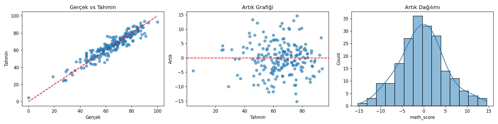
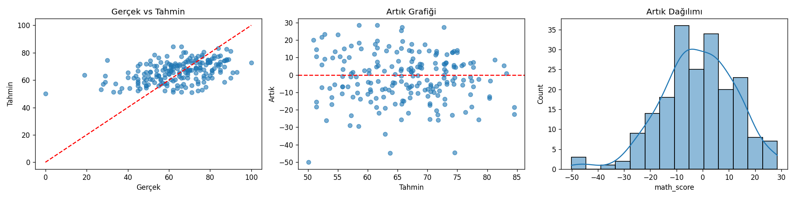
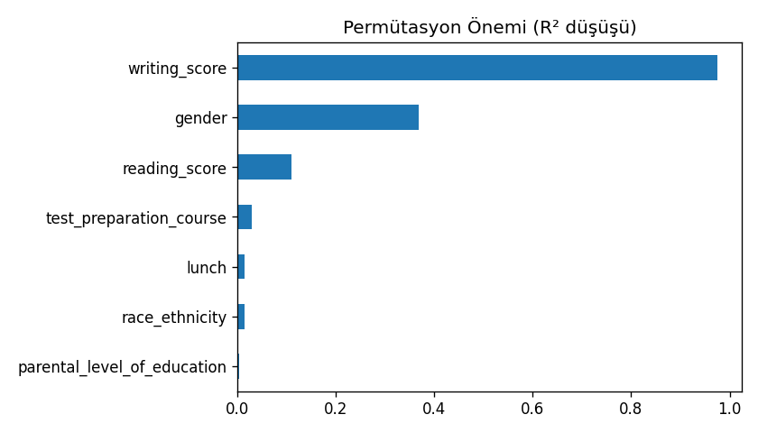
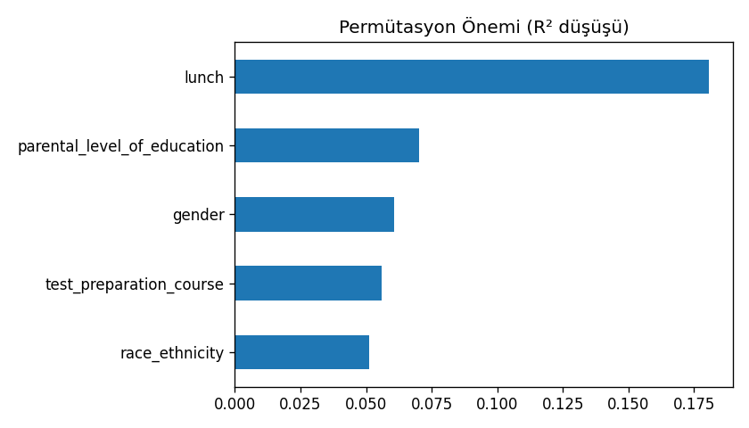

# student_performance_prediction
Öğrencilerin matematik skorunu demografik ve eğitimsel özelliklerden tahmin eden uçtan uca makine öğrenmesi projesi (EDA, Pipeline, Ridge/RF/GBM karşılaştırma, GridSearchCV, permütasyon önemi).

#  Öğrenci Performansı: Matematik Skoru Tahmini

Bir öğrencinin **matematik skorunu**, demografik ve eğitimsel özelliklerinden tahmin eden uçtan uca bir makine öğrenmesi projesi (regresyon).

Proje; keşifsel veri analizi, ön işleme, model karşılaştırma, hiperparametre ayarı, değerlendirme ve model yorumlamayı kapsar.

##  Veri Seti

`data/StudentsPerformance.csv` : 1000 öğrenci, 8 sütun, eksik değer yok.

| Sütun | Tip | Açıklama |
|---|---|---|
| `gender` | kategorik | Cinsiyet (female / male) |
| `race/ethnicity` | kategorik | Grup A-E |
| `parental level of education` | **ordinal** | Ebeveyn eğitim düzeyi (6 seviye) |
| `lunch` | kategorik | standard / free/reduced |
| `test preparation course` | kategorik | none / completed |
| `math score` | sayısal | **Hedef değişken** (0-100) |
| `reading score` | sayısal | Okuma skoru (0-100) |
| `writing score` | sayısal | Yazma skoru (0-100) |

##  Proje Yapısı

```
students-performance-ml/
├── data/
│   └── StudentsPerformance.csv
├── notebooks/
│   └── student_performance_analysis.ipynb   # bölüm bölüm açıklamalı analiz
├── src/
│   └── train.py                             # komut satırından eğitim betiği
├── models/                                  # kaydedilen modeller (.pkl, git'e eklenmez)
├── reports/
│   ├── figures/                             # üretilen grafikler
│   └── metrics_*.json                       # senaryo metrikleri
├── requirements.txt
├── LICENSE
└── README.md
```

##  Kurulum ve Çalıştırma

```bash
git clone https://github.com/Ardajs/students-performance-ml.git
cd students-performance-ml

python -m venv .venv
source .venv/bin/activate        # Windows: .venv\Scripts\activate
pip install -r requirements.txt
```

**Notebook ile:**

```bash
jupyter notebook notebooks/student_performance_analysis.ipynb
```

**Komut satırı ile:**

```bash
python src/train.py              # reading/writing skorlarıyla
python src/train.py --no-scores  # yalnızca sosyo-demografik özelliklerle
```

Çıktılar `models/`, `reports/figures/` ve `reports/` altına yazılır.

> Notebook Google Colab'da da çalışır: dosyayı açıp çalıştırdığınızda CSV bulunamazsa yükleme penceresi çıkar.

##  Yöntem

1. **EDA:** dağılımlar, korelasyon matrisi, kategorilere göre boxplot
2. **Temizleme:** sütun adı standardizasyonu, IQR ile aykırı değer kontrolü (aykırı değerler gerçek gözlemler olduğu için silinmedi)
3. **Ön işleme** (`ColumnTransformer`):
   - Ebeveyn eğitimi → sıralı (ordinal) kodlama
   - Diğer kategorikler → one-hot kodlama
   - Sayısal değişkenler → standartlaştırma
4. **Veri sızıntısını önleme:** tüm ön işleme `Pipeline` içinde, yalnızca eğitim verisine fit edilir
5. **Model karşılaştırma (5-fold CV):** Linear Regression, Ridge, Lasso, Random Forest, Gradient Boosting
6. **Hiperparametre ayarı:** `GridSearchCV`
7. **Değerlendirme:** MAE, RMSE, R² (test seti yalnızca bir kez kullanılır)
8. **Yorumlama:** permütasyon önemi, artık analizi

##  Sonuçlar

İki senaryo karşılaştırıldı. `reading` ve `writing` skorları matematikle yüksek korelasyonlu olduğu (≈0.80-0.82) için, bu skorların modele girmesi sonucu belirgin şekilde etkiler.

| Senaryo | CV R² | Test MAE | Test RMSE | Test R² |
|---|---|---|---|---|
| Reading + writing skorları **dahil** | 0.870 | 4.18 | 5.37 | **0.882** |
| Yalnızca sosyo-demografik özellikler | 0.245 | 11.16 | 14.06 | **0.188** |

Her iki senaryoda en iyi model **Ridge Regression** (`alpha=1`) oldu. 5-fold CV'de doğrusal modeller, Random Forest ve Gradient Boosting'den daha iyi veya eşit çıktı.

### Öne çıkan bulgular

- **Skorlar dahilken** model varyansın yaklaşık %88'ini açıklıyor. Ancak bu, "sınav öncesi tahmin" anlamına gelmez; diğer iki skor aynı sınav döneminin çıktılarıdır.
- **Skorlar olmadan** model yalnızca varyansın yaklaşık %19'unu açıklıyor. Demografik özellikler tek başına matematik başarısını zayıf öngörüyor.
- Skorsuz senaryoda en etkili özellik **`lunch`** (öğle yemeği türü). Ardından ebeveyn eğitimi, cinsiyet ve hazırlık kursu geliyor.
- Ağaç tabanlı modellerin doğrusal modelleri geçememesi, ilişkilerin büyük ölçüde doğrusal olduğunu ve veri boyutunun (1000 satır) karmaşık modelleri desteklemediğini düşündürüyor.

### Görseller

| Skorlar dahil | Skorlar hariç |
|---|---|
|  |  |
|  |  |

##  Sınırlılıklar

- Veri seti küçük (1000 satır) ve büyük olasılıkla sentetik/örneklem bir veri; sonuçlar gerçek dünyaya genellenmeyebilir.
- `race/ethnicity` anonimleştirilmiş gruplardır ve model yorumlarında nedensel çıkarım yapılmamalıdır.
- Özellik önemi, nedensellik değil model bağımlılığını gösterir.

##  Olası Geliştirmeler

- Sınıflandırma (geçti/kaldı) için eşik ve sınıf dengesi analizi
- Etkileşim özellikleri ve polinom terimleri
- SHAP ile daha ayrıntılı model yorumlama
- Basit bir Streamlit arayüzü ile canlı tahmin

##  Lisans

MIT Lisansı: ayrıntılar için [LICENSE](LICENSE) dosyasına bakın.
